# EATO Gym Owner portal: screens and workflow

Screens captured from the running prototype (`npm run dev`, http://localhost:5173) at phone width, signed in as the **Gym owner** demo account (Alex Morgan, owner of FitZone Fitness). Every screenshot lives in `screens/` next to this file, numbered in the order an owner moves through the portal.

**How you get here:** the real app picks the workspace from the signed-in account's role. In the prototype, tap **Switch account (demo)** (the ⇄ icon on Home and on every workspace header) and choose **Gym owner** (screen 00). Owner routes live under `/owner/*`, and anyone with another role is sent back to their own home.

**Owner tab bar:** Home · Members · Check-in · Community · Review · Gym. Members and Review show a badge when something is waiting.

> Prototype note: all data is mock data held in memory. No payment is taken, no SMS or email is sent, and QR scanning is simulated by picking what the camera "sees".

---

## Screen map

| # | Screen | Route | Reached from |
| --- | --- | --- | --- |
| 00 | Switch account (demo) sheet | any header ⇄ | Home ⇄ icon |
| 01 | Home dashboard | `/owner` | Tab bar |
| 02 | Members | `/owner/members` | Tab bar |
| 03 | Check-in tab | `/owner/attendance` | Tab bar, "in the gym now" card |
| 04 | Community | `/owner/community` | Tab bar |
| 05 | Review (moderation) | `/owner/moderation` | Tab bar, attention list |
| 06 | Gym | `/owner/gym` | Tab bar |
| 07 | Scan member QR (simulated) | `/owner/attendance/scan` | Check-in › Scan member QR |
| 08 | Verification, eligible | `/owner/attendance/verify` | After a scan |
| 09 | Check-in successful | `/owner/attendance/checked-in/:recordId` | Check in {name} |
| 10 | Verification failed | `/owner/attendance/verify` | After a bad scan |
| 11 | Today's list | `/owner/attendance/today` | Check-in tab |
| 12 | Visit detail | `/owner/attendance/visit/:recordId` | Any attendance row |
| 13 | Check-out QR | `/owner/attendance/qr` | Check-in tab, Gym tab |
| 14 | Front-desk display | `/owner/attendance/qr/display` | Check-out QR › Open front-desk display |
| 15 | Events | `/owner/schedule` | Community › Events card |
| 16 | Gym assistant (owner side) | `/owner/assistant` | Community or Gym tab |
| 17 | Notify members | `/owner/notify` | Home, Members, Community, Gym |
| 18 | Renewals | `/owner/renewals` | Home attention list, Members tab |
| 19 | Manage gym | `/gyms/:id/manage` | Gym tab |
| 20 | Edit gym profile | `/gyms/:id/manage/profile` | Manage gym |
| 21 | Subscription | `/gyms/:id/manage/subscription` | Manage gym |
| 22 | Trainers | `/gyms/:id/manage/trainers` | Manage gym, Home › Coaching team |
| 23 | Members (manage) | `/gyms/:id/manage/members` | Manage gym |
| 24 | Invitations | `/gyms/:id/manage/invitations` | Manage gym, Community › Sent invitations |
| 25 | Announcements | `/gyms/:id/manage/announcements` | Manage gym, Community › Manage |
| 26 | Community settings | `/gyms/:id/manage/settings` | Manage gym, Community › Rules |
| 27 | Invite members | `/gyms/:id/invite` | Home › Invite, Community › Invite members |
| 28 | Create event | `/gyms/:id/events/new` | Home › Event, Events › Create event |
| 29 | Gym page as the owner sees it | `/gyms/:id` | Gym tab › Gym page |

---

## 1. Switching in and the Home dashboard


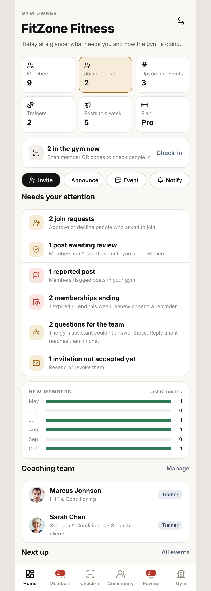

**Home** (`/owner`) is "today at a glance". Top to bottom:

1. **Stat tiles:** Members, Join requests (highlighted when pending), Upcoming events, Trainers, Posts this week, Plan.
2. **In the gym now** card with a count. Tapping **Check-in** opens the Check-in tab.
3. **Quick actions:** Invite · Announce · Event · Notify.
4. **Needs your attention** list. Each row opens the screen that fixes it: join requests, posts awaiting review, reported posts, memberships ending (renewal or trial within 7 days), questions the gym assistant passed on, invitations not accepted yet.
5. **New members** per month for the last 6 months.
6. **Coaching team** with each trainer's client count, and **Manage** (Trainers).
7. **Next up:** the next event, with **All events**.

With more than one managed gym, the gym logo in the header switches gyms.

---

## 2. Members

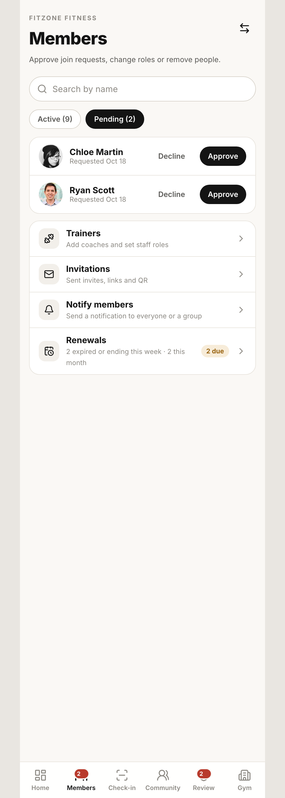
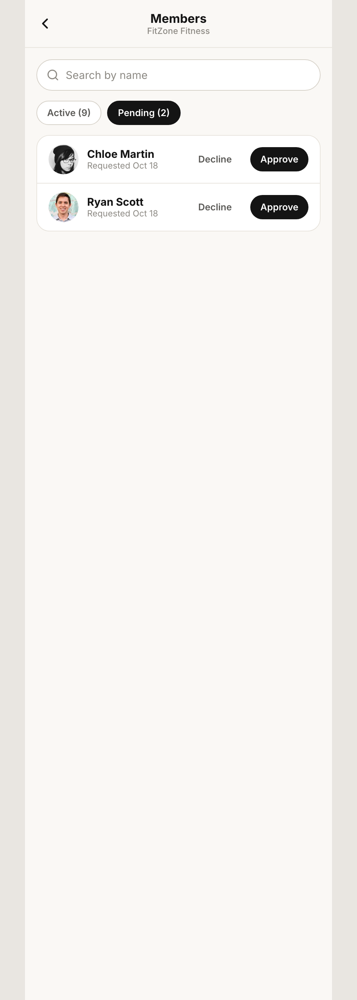
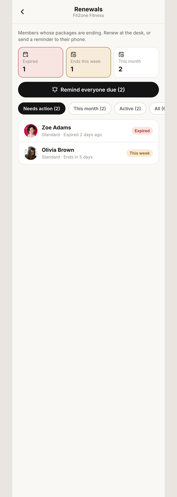

1. **Members tab** (02) is the same member manager as Manage Gym › Members (23), plus links to Trainers, Invitations and Renewals.
2. Search, filter by status (active, pending) and role.
3. **Join requests:** **Approve** or **Decline**. Approving sends the member a notification.
4. **Change role** (member, trainer, admin) or **Remove** (confirm). The owner is protected and cannot be removed.
5. **Renewals** (18): every member's package sorted by days left, flagged **Expired**, **This week**, **This month** or **Active**. Tap a member to **renew** (+1 or +3 months, recorded only, no payment) or **send a renewal reminder**. **Remind everyone due** sends one reminder to everyone expired or ending this week. Members get a notification when renewed.

---

## 3. Check-in (QR attendance at the front desk)

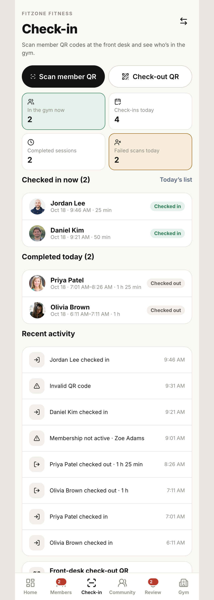
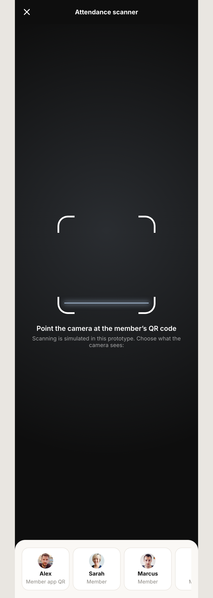
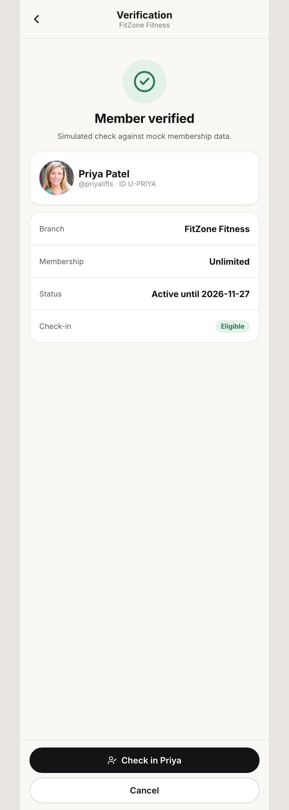
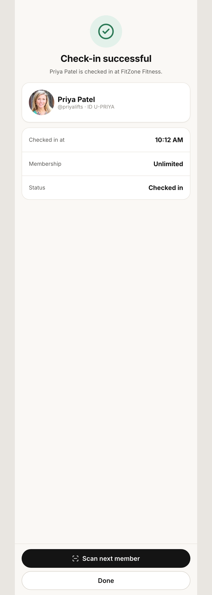
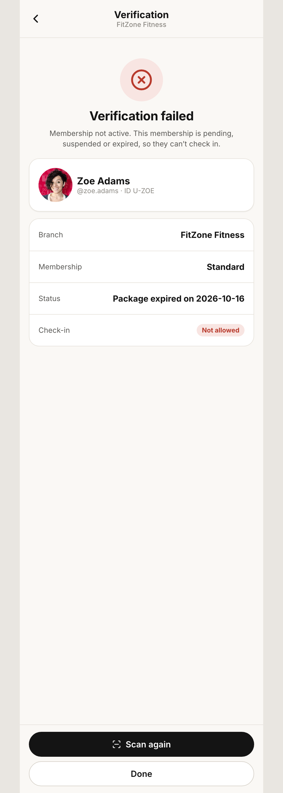
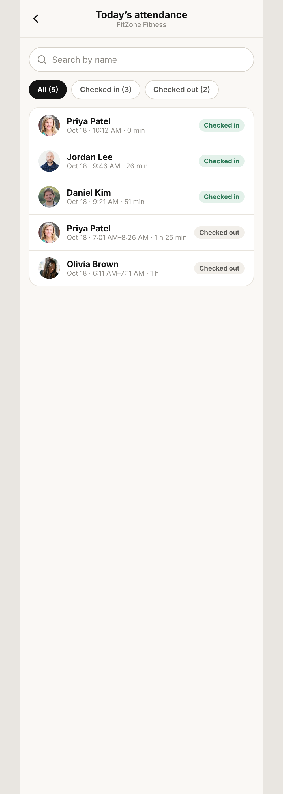
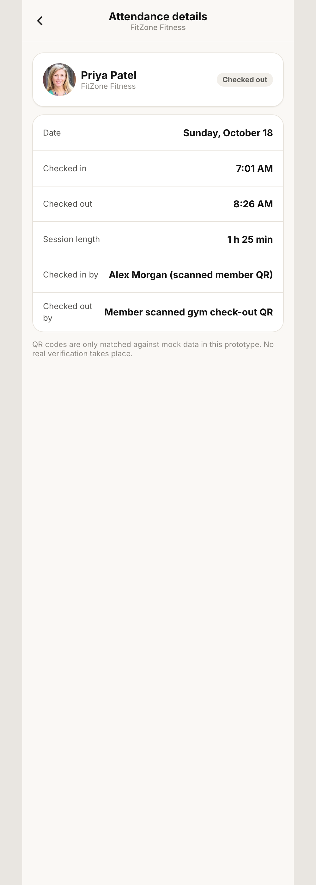
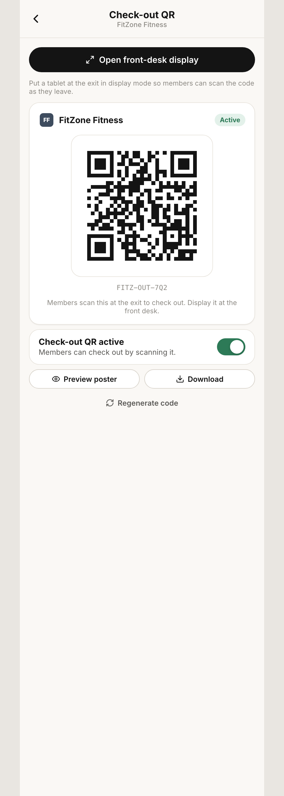
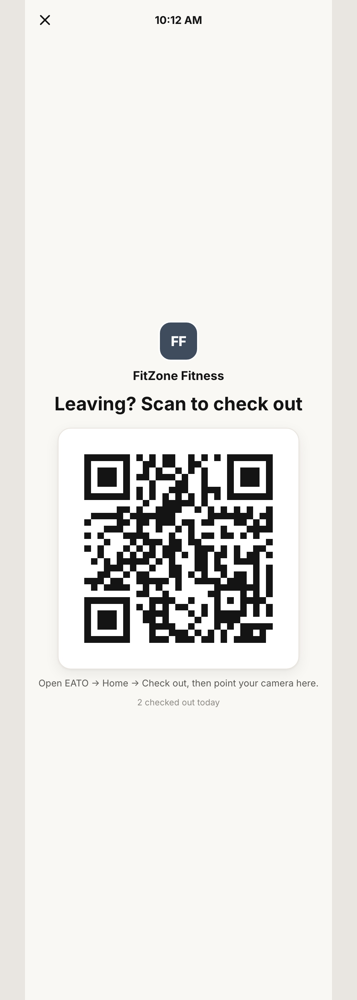

**Check-in tab** (03): **Scan member QR** and **Check-out QR** buttons; counts for in the gym now, check-ins today, completed sessions and failed scans; who is checked in now with live durations; completed today; recent activity; **Today's list**.

**Check-in flow (owner scans the member's QR)**

1. **Scan member QR** (07). The scanner is simulated: pick whose phone is in front of the camera. Options include members, someone from another gym, an unknown QR and a blurry code.
2. **Verification** (08) shows the member's photo and name, branch, membership tier, status and eligibility. If their package ends this week, a renewal warning appears with a link to Renewals.
3. **Check in {name}** → **Check-in successful** (09) with **Scan next member** and **Done**. The member gets a notification and sees the active session on their Home.
4. **Failure** (10): *Invalid QR code*, *Couldn't read the code*, *Not a member here*, *Membership not active* (pending, suspended or expired, for example Zoe) and *Already checked in* (for example Jordan). Each is recorded as a failed scan. Repeated taps or a second scan never create a second check-in.

**Today's list** (11): search; filter All, Checked in, Checked out. Tap a row for **Visit detail** (12): member, check-in and check-out time, duration, how they checked out.

**Check-out QR** (13): the gym's code members scan on the way out. **Save as PNG**, turn it **on or off**, and **Open front-desk display** (14): a full-screen view for a tablet at the exit with a clock, "Leaving? Scan to check out", and today's check-out count. If the code is off, the display says so instead.

---

## 4. Community

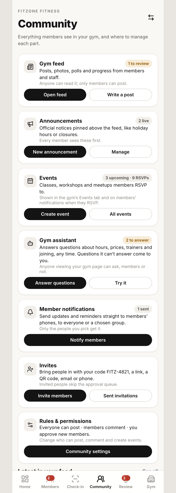
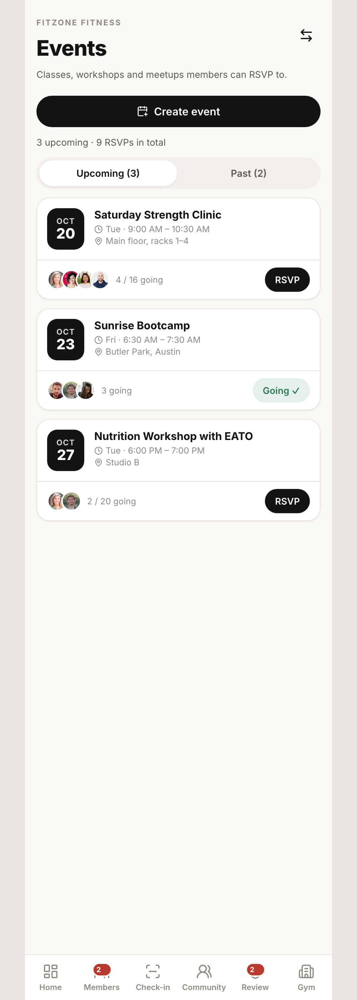
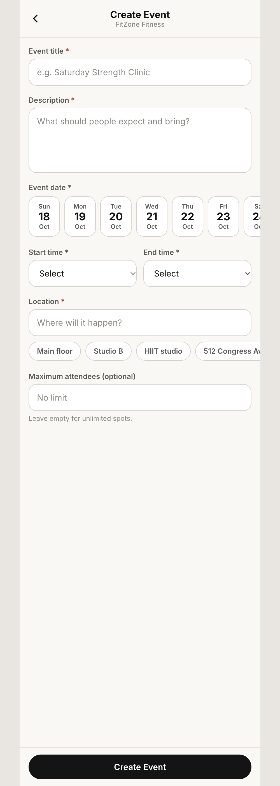
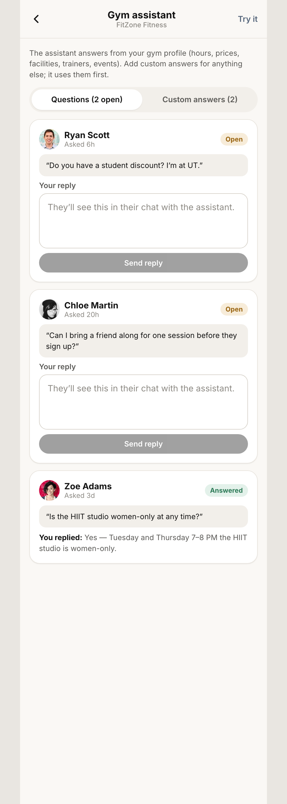
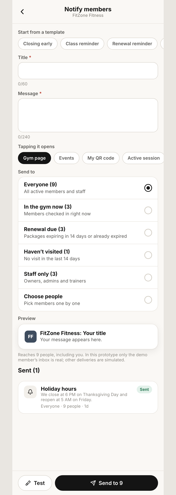
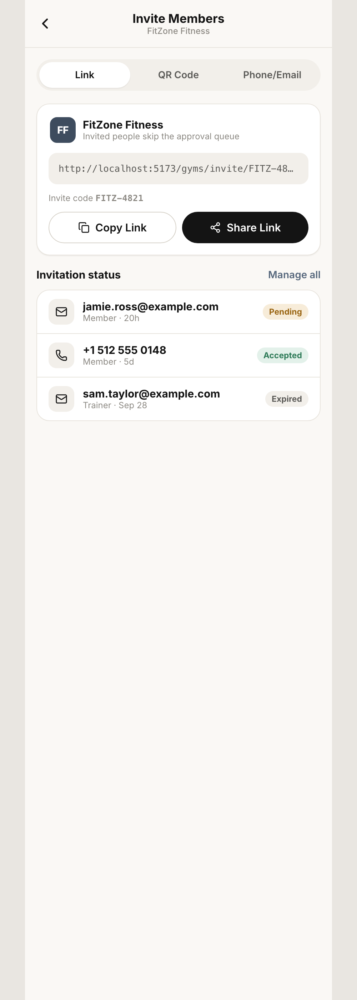
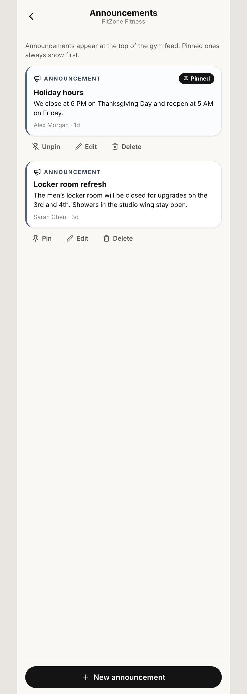
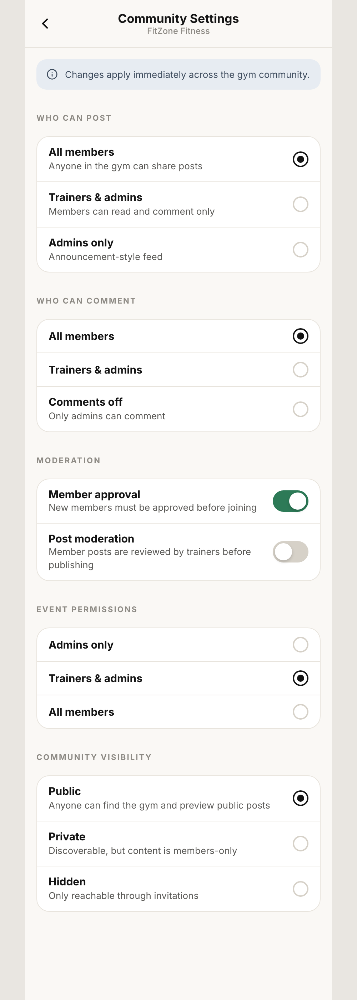

**Community tab** (04) is a map of everything members see in the gym. Each card says what it is, who sees it, a live count, and has a main action plus a manage button:

| Card | Count shown | Actions |
| --- | --- | --- |
| Gym feed | posts to review | Open feed · Write a post |
| Announcements | live announcements | New announcement · Manage (25) |
| Events | upcoming · RSVPs | Create event (28) · All events (15) |
| Gym assistant | questions to answer | Answer questions (16) · Try it |
| Member notifications | sent | Notify members (17) |
| Invites | invite code | Invite members (27) · Sent invitations (24) |
| Rules & permissions | current rules | Community settings (26) |

Below the cards: **Latest in your feed**.

**Events** (15): upcoming and past events with RSVP totals. **Create event** (28): title, description, date, start and end time, location, optional maximum attendees. Capacity is enforced when members RSVP.

**Gym assistant** (16): the member-facing assistant is rule-based and answers from gym data (hours, prices, address, facilities, trainers, events, how to join, contact, guidelines). Here the owner:
1. Writes **Custom answers** (FAQs), which are used before the built-in ones.
2. **Replies to questions** the assistant could not answer. The reply appears in the asker's chat as *FitZone team* and sends them a notification.

**Notify members** (17):
1. Start from a template (Closing early, Class reminder, Renewal reminder, We miss you, Check-out reminder) or write a title (60 characters) and message (240).
2. Choose what tapping it opens: gym page, events, My QR code, active session or nothing.
3. Choose **Send to**, each with a live count: Everyone · In the gym now · Renewal due · Haven't visited (14 days) · Staff only · Choose people. Pending and suspended accounts are never included.
4. Check the preview, then **Test** (only to you) or **Send to N** (confirm). Sent notifications are listed with audience, reach and time.

**Invite members** (27): link (copy or share), QR (save as PNG or share), phone or email with a role (recorded as Pending, no message is sent), and the invitation status list.

**Announcements** (25): create, edit, pin or unpin, delete (confirm). Pinned ones sit at the top of the gym feed.

**Community settings** (26): who can post, who can comment, member approval, post moderation, event permissions, visibility. Changes apply instantly.

---

## 5. Review (moderation)

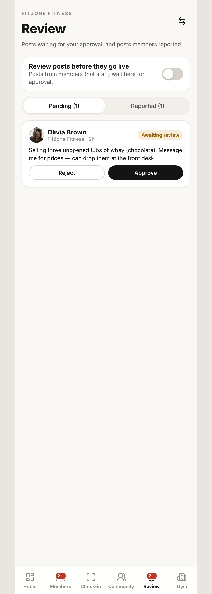

1. **Review posts before they go live** on or off (the same switch as post moderation in Community settings).
2. **Pending:** member posts held for review. **Approve** publishes; **Reject** removes.
3. **Reported:** posts in this gym that members reported, with reasons. **Keep post** dismisses the reports; **Remove post** deletes it. EATO's super admins see the same reports in their own queue.

---

## 6. Gym

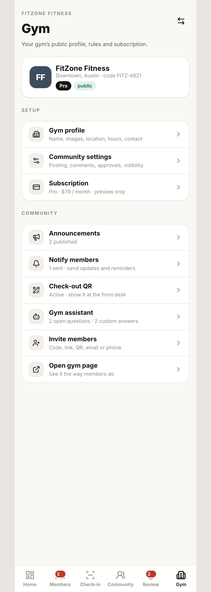
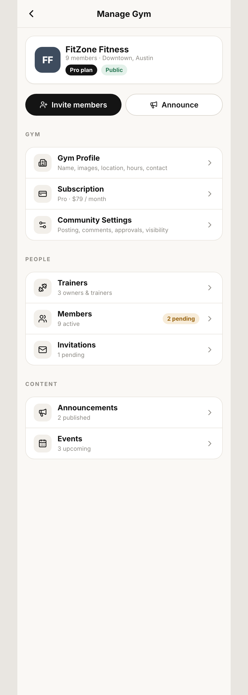
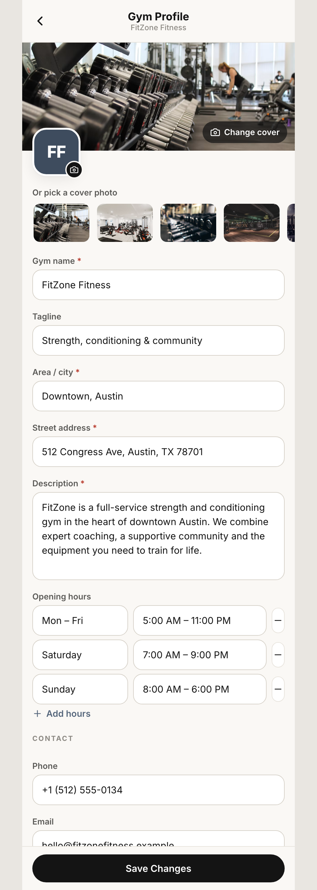
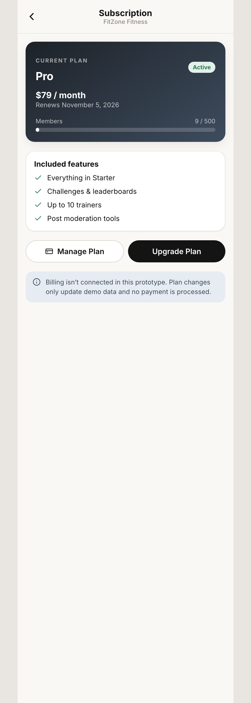
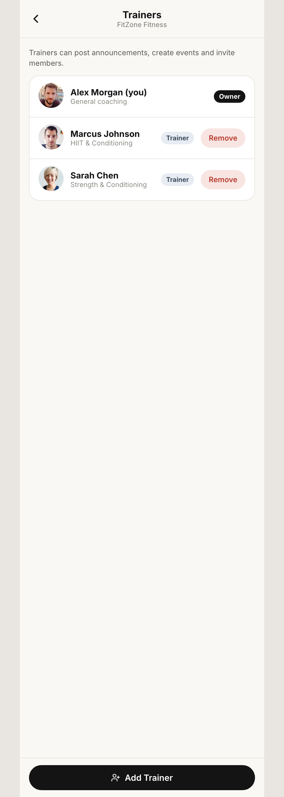
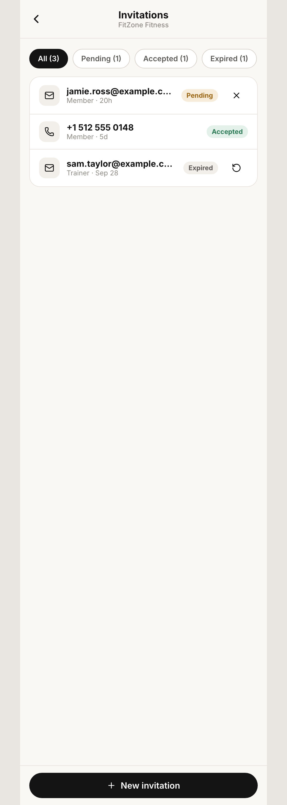
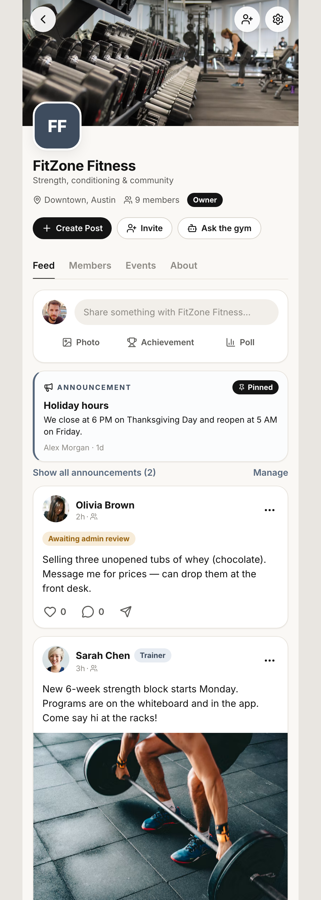

**Gym tab** (06) links to every gym-level screen. Most reuse the member-side Manage Gym screens (`/gyms/:id/manage/*`):

- **Gym profile** (20): name, tagline, logo and cover (upload or stock photo), location, address, description, opening hours, contact details. Validated; changes show immediately on the gym page.
- **Subscription** (21): the plan card. **Upgrade** and **Manage** switch plans after a confirmation that no payment is processed.
- **Trainers** (22): list, **Add Trainer** (promote a member), remove the trainer role (confirm).
- **Members** (23): see section 2.
- **Invitations** (24): filter by status, **revoke** pending, **renew** expired.
- **Announcements** (25) and **Community settings** (26): see section 4.
- **Gym assistant**, **Invite**, **Check-out QR**: see sections 3 and 4.
- **Gym page** (29): the public gym page as the owner sees it, with Feed, Members, Events and About, plus owner-only controls (Manage, Invite, post approval in each post's ⋯ menu). The owner cannot leave the gym.

---

## 7. End-to-end owner day

```
Switch account (demo) ──► Gym owner ──► /owner Home
│
├── Needs your attention
│   ├── Join requests ──► Members ──► Approve / Decline
│   ├── Post awaiting review ──► Review ──► Approve / Reject
│   ├── Reported post ──► Review ──► Keep / Remove
│   ├── Memberships ending ──► Renewals ──► Renew / Remind
│   ├── Questions for the team ──► Gym assistant ──► Reply
│   └── Invitation not accepted ──► Invitations ──► Revoke / Renew
│
├── Quick actions: Invite · Announce · Event · Notify
│
├── Check-in tab
│   ├── Scan member QR ──► Verification ──► Check in ──► Success ──► Scan next
│   │                                └── Failed (inactive, duplicate, not a member, bad code)
│   ├── Today's list ──► Visit detail
│   └── Check-out QR ──► Front-desk display (tablet at the exit)
│
├── Community tab ──► Feed · Announcements · Events · Assistant · Notify · Invites · Rules
│
└── Gym tab ──► Profile · Subscription · Trainers · Members · Invitations ·
                Announcements · Settings · Assistant · Invite · Check-out QR · Gym page
```

---

## What is simulated

| Real-world step | Prototype stand-in |
| --- | --- |
| Scanning a member's QR | Pick who is in front of the camera |
| Member scanning the check-out QR | Done from the member side with a simulated scanner |
| Phone or email invitations | Recorded as Pending; nothing is sent |
| Plan upgrade, renewals | Recorded only; no payment |
| Notifications to members | Only the demo member's inbox is real; other deliveries are simulated |
| Gym assistant | Rule-based answers from gym data and owner FAQs, not an AI model |
| Signing in as an owner | Switch account (demo) sheet |
