# EATO Super Admin portal: screens and workflow

Screens captured from the running prototype (`npm run dev`, http://localhost:5173) at phone width, signed in as the **Super admin** demo account (Maya Ortiz, EATO). Every screenshot is in `screens/` next to this file, numbered in the order an admin moves through the portal.

**How you get here:** tap **Switch account (demo)** (the ⇄ icon on Home and on every workspace header) and choose **Super admin** (screen 00). Admin routes live under `/admin/*`; anyone with another role is sent back to their own home.

**Admin tab bar:** Overview · Users · Gyms · Reports · Content. Reports shows a badge with open report groups. Attendance and Kitchen orders open from Overview.

> Prototype note: all data is mock data held in memory. Plan changes are recorded only, no payment is taken, and QR scanning is simulated.

---

## Screen map

| # | Screen | Route | Reached from |
| --- | --- | --- | --- |
| 00 | Switch account (demo) sheet | any header ⇄ | Home ⇄ icon |
| 01 | Overview | `/admin` | Tab bar |
| 02 | Users | `/admin/users` | Tab bar |
| 03 | User detail, trainer | `/admin/users/:userId` | User row, "Verify …" to-do |
| 04 | User detail, member | `/admin/users/:userId` | User row, report author |
| 05 | Gyms | `/admin/gyms` | Tab bar |
| 06 | Gym detail | `/admin/gyms/:gymId` | Gym row, "on a trial" to-do |
| 07 | Create gym | `/admin/gyms/new` | Gyms › Create gym |
| 08 | Reports | `/admin/reports` | Tab bar, "reported posts" to-do |
| 09 | Content (promotions) | `/admin/content` | Tab bar |
| 10 | Promotion editor | `/admin/content/:promoId` | Promotion row |
| 11 | New promotion | `/admin/content/new` | Content › New |
| 12 | Kitchen orders | `/admin/orders` | Overview button, "meal order" to-do |
| 13 | Attendance › Today | `/admin/attendance` | Overview button, gym detail |
| 14 | Attendance › History | `/admin/attendance` | Attendance tab |
| 15 | Attendance › Failed | `/admin/attendance` | Attendance tab |
| 16 | Attendance › QR | `/admin/attendance?view=qr` | Attendance tab |
| 17 | Visit detail | `/admin/attendance/visit/:recordId` | Any attendance row |
| 18 | Member Home with live promotions | `/` | Result of Content changes |

---

## 1. Overview

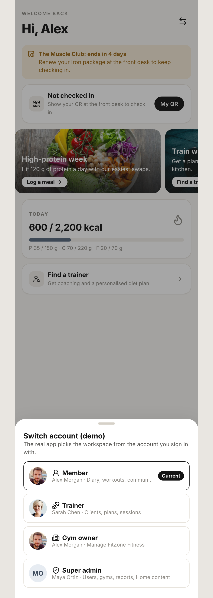
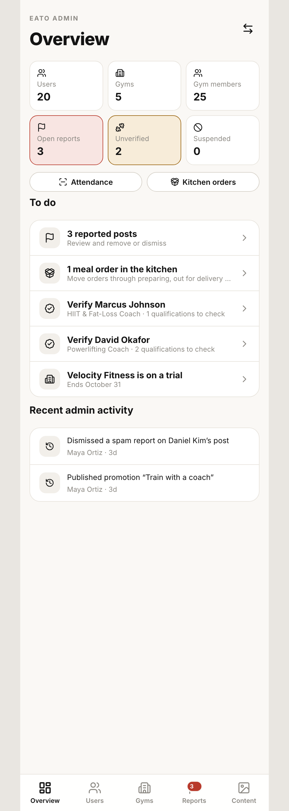

1. **Stat tiles:** Users, Gyms, Gym members, Open reports (red when any), Unverified trainers (amber when any), Suspended accounts.
2. **Attendance** and **Kitchen orders** buttons.
3. **To do** list, each row opening the screen that resolves it: reported posts, meal orders in the kitchen, trainers to verify, gyms on trial with the end date.
4. **Recent admin activity:** the audit log of admin actions with who and when.

---

## 2. Users

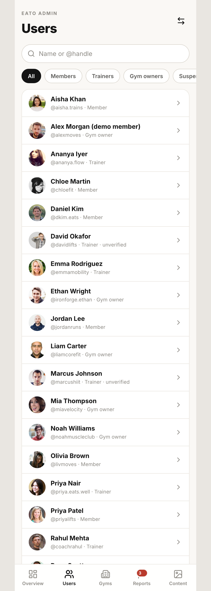
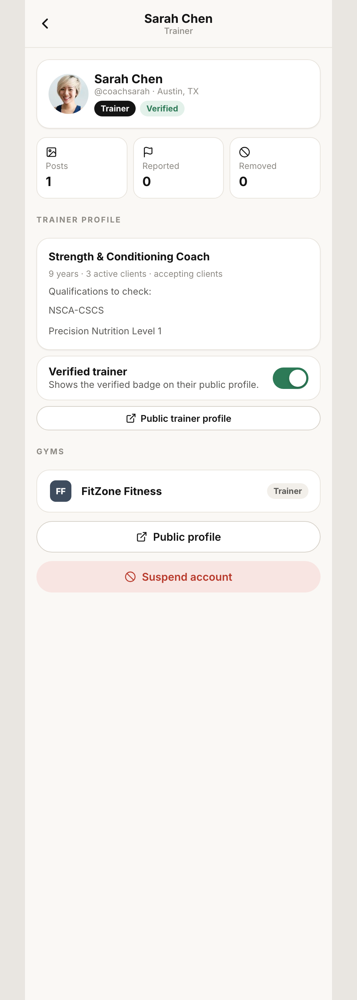
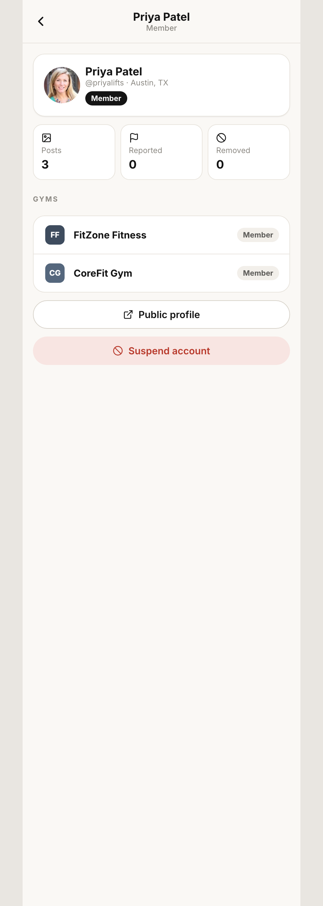

1. Search and filter: **All · Members · Trainers · Gym owners · Suspended**.
2. **User page** shows their gyms, posts and reports against them.
3. **Trainers** also show qualifications and a **Verified trainer** switch. Verifying clears the Overview to-do and shows the badge on the trainer's public profile.
4. **Suspend account** (confirm) hides their posts from everyone else's feeds and removes trainers from search. Members see a suspension notice on Home. **Reinstate** undoes it.
5. Every action is written to the audit log.

---

## 3. Gyms

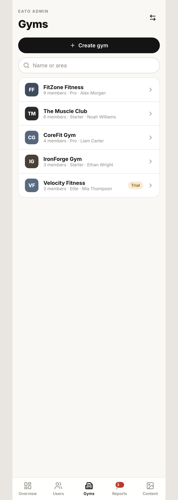
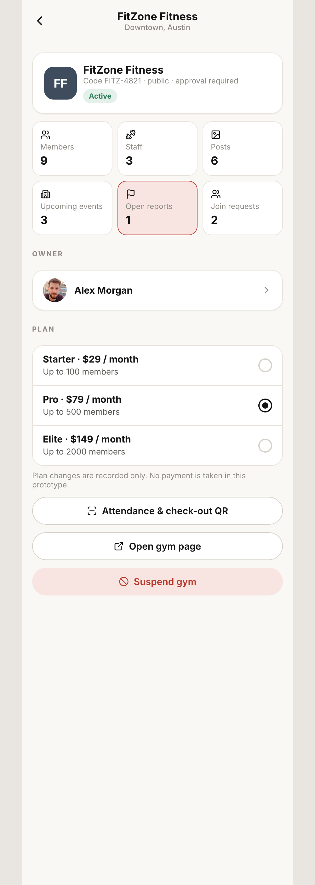
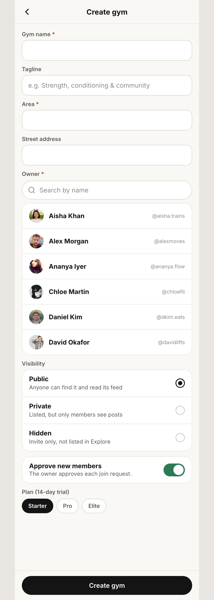

1. **Gyms list:** every gym with plan, owner and status (active, trial, suspended).
2. **Create gym** (07): name, area, owner, visibility, approval mode, plan. Creating starts a **14-day trial** and makes the chosen person its owner, who can then switch into the Gym owner workspace.
3. **Gym detail** (06): change the plan (recorded only), link to the gym's attendance, and **Suspend gym**, which removes it from Explore and hides its posts. Reinstate undoes it.

---

## 4. Reports (moderation)

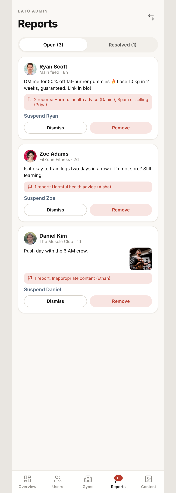

1. **Open** and **Resolved** tabs. Reports are grouped by post, showing the author, where it was posted (main feed or a gym), the post, and every reason with its reporter.
2. **Remove** deletes the post and tells the reporters.
3. **Dismiss** keeps the post and closes the reports.
4. **Suspend {author}** suspends the author directly (see Users).
5. Reports come from members' **Report post** action. Gym posts appear in both this queue and the gym owner's Review tab, so either side can resolve them.

---

## 5. Content (Home promotions)

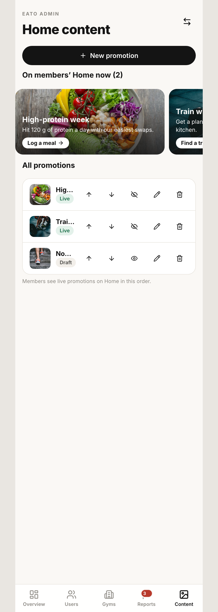
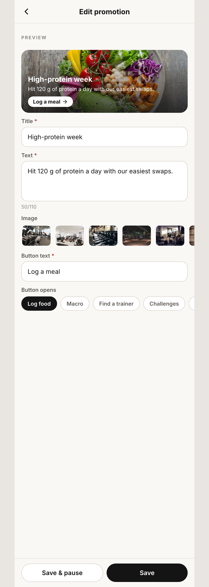

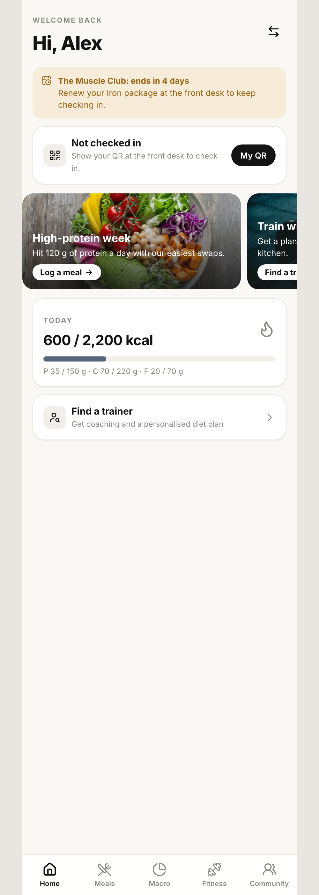

1. **Content list:** every promotion with status **Draft**, **Live** or **Paused**. Reorder, pause or delete (confirm).
2. **Editor** (10, 11): live preview, title (required), text (110 characters), image, button text, and which screen the button opens, chosen from a fixed list (Log food, Macro, Find a trainer, Challenges and so on).
3. **Save draft** or **Publish**.
4. Only **live** promotions show on members' Home, in the admin's order (18).

---

## 6. Kitchen orders

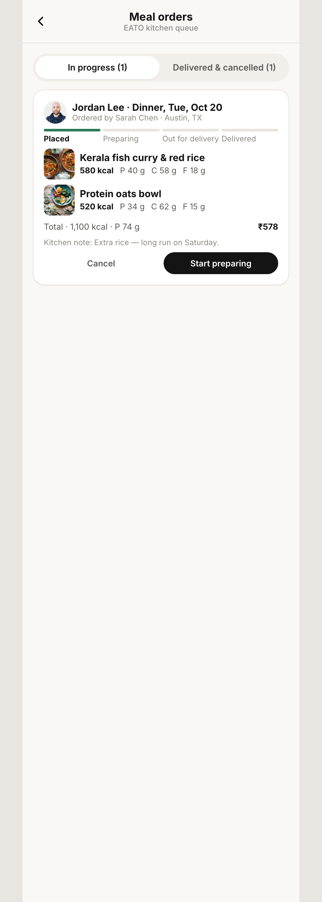

1. Trainers order EATO kitchen meals for their clients. Each order lands here.
2. The admin moves each order along: **Start preparing → Send out → Mark delivered**. The member sees each step in their Meal orders screen.
3. Orders can be cancelled only while still *Placed*, by the trainer, the client or the admin.
4. Once delivered, the member can log the meals to their diary once.

---

## 7. Attendance (all gyms)

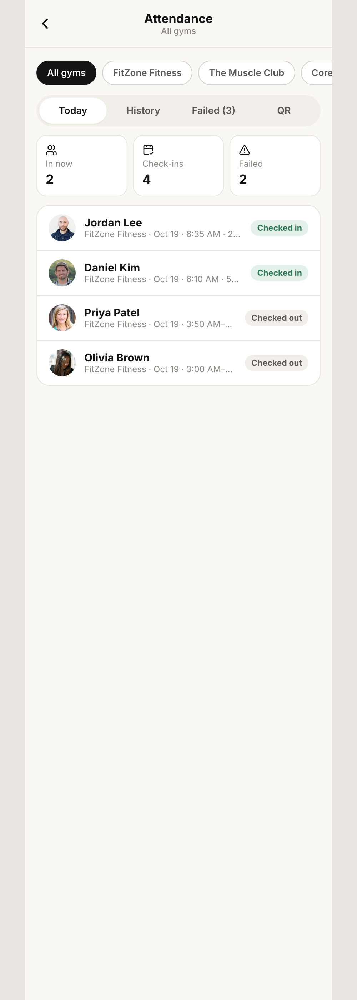
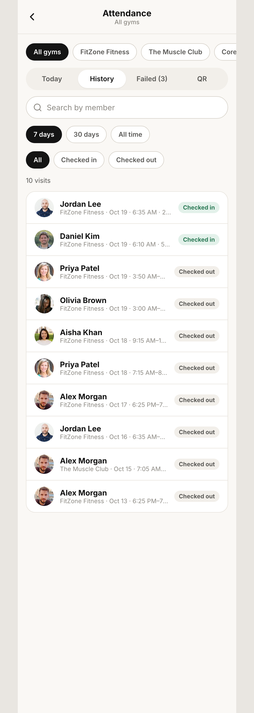
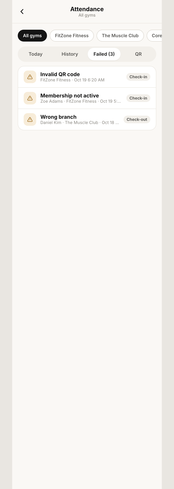
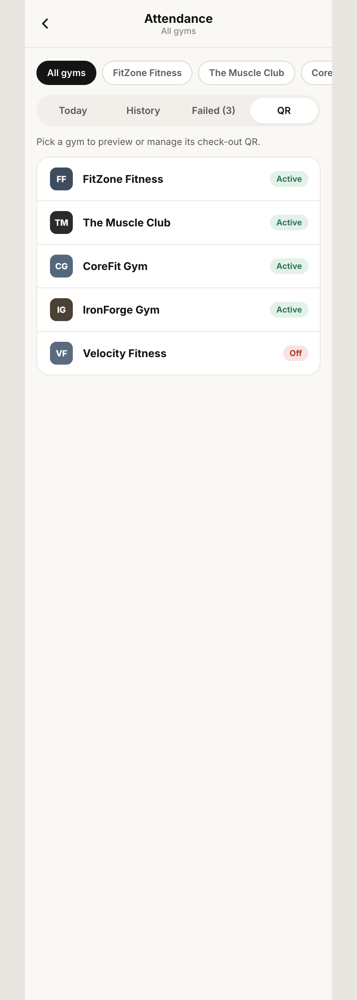
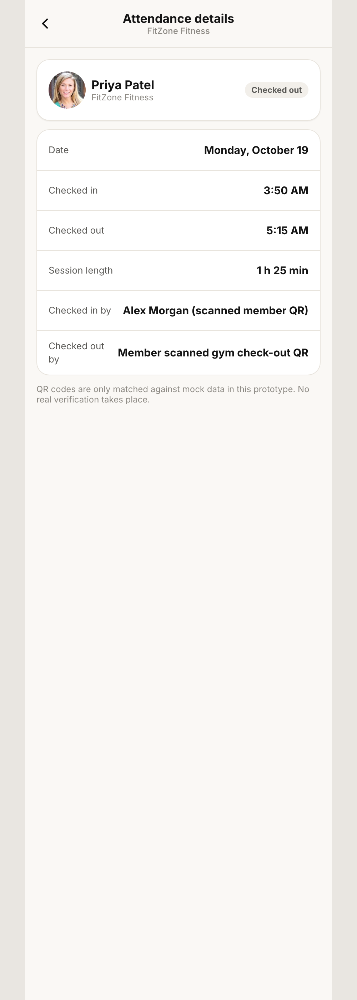

1. Choose **All gyms** or one gym with the chips at the top.
2. **Today:** who is in now and completed visits.
3. **History:** search, period (7 days, 30 days, all time) and status (all, checked in, checked out).
4. **Failed:** failed scans with reason, person, gym, time and whether it was check-in or check-out (for example *Invalid QR code*, *Membership not active*, *Wrong branch*).
5. **QR:** each gym's check-out QR with preview, a printable poster preview, **PNG download**, **on/off**, and **Regenerate code**, which makes old printouts stop working.
6. Tap any visit for **Visit detail** (17).

---

## 8. End-to-end admin day

```
Switch account (demo) ──► Super admin ──► /admin Overview
│
├── To do
│   ├── Reported posts ──► Reports ──► Remove / Dismiss / Suspend author
│   ├── Meal order in kitchen ──► Kitchen orders ──► Preparing ──► Out ──► Delivered
│   ├── Verify trainer ──► User detail ──► Verified trainer switch
│   └── Gym on trial ──► Gym detail ──► Change plan / Suspend
│
├── Users ──► search / filter ──► User detail ──► Verify · Suspend · Reinstate
├── Gyms ──► Create gym (14-day trial, assign owner) · Gym detail
├── Reports ──► Open / Resolved
├── Content ──► New / Edit promotion ──► Draft / Publish / Pause / Reorder ──► Member Home
└── Attendance ──► Today · History · Failed · QR (download, on/off, regenerate)
```

---

## What is simulated

| Real-world step | Prototype stand-in |
| --- | --- |
| Signing in as an admin | Switch account (demo) sheet |
| Plan changes and trials | Recorded only; no payment |
| Trainer verification | A switch on mock qualification data |
| Kitchen preparing and delivering | The admin moves orders along by hand |
| QR scans | Picked in a simulated scanner; matched against mock data |
| Notifications to reporters and users | Only the demo member's inbox is real |
